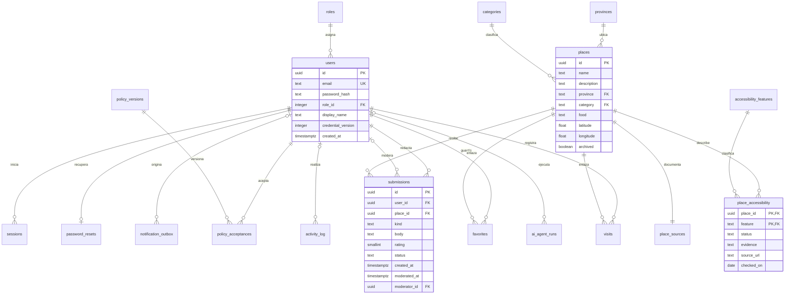

# Modelo relacional de Rutea

El esquema inicial y las migraciones SQL son la definición ejecutable. Los lugares se archivan para conservar las referencias históricas. Las cuentas se eliminan y se limpian sus recursos privados. El comprobante de baja no contiene la identidad.

## Diccionario

| Tabla | Clave y atributos | Finalidad |
| --- | --- | --- |
| `roles` | `id` entero PK, `code` texto único | Roles de autorización |
| `users` | `id` UUID PK, `email` texto único, `password_hash` texto, `role_id` entero FK, `display_name` texto, `credential_version` entero, `created_at` fecha/hora | Identidad, permisos y control de credenciales |
| `sessions` | `id` UUID PK, `user_id` UUID FK, `expires_at` fecha/hora, `credential_version` entero | Revocación de JWT y expiración |
| `password_resets` | `user_id` UUID PK/FK, `digest` texto único, `expires_at` fecha/hora | Enlace de recuperación activo, de un solo uso |
| `policy_versions` | `version` texto PK | Identificador de versión legal |
| `policy_acceptances` | `user_id` UUID FK, `policy_version` texto FK, ambos PK, `accepted_at` fecha/hora | Evidencia de aceptación |
| `provinces`, `categories`, `accessibility_features` | `code` texto PK, `name` texto único | Taxonomías |
| `places` | `id` UUID PK, `name`, `description`, `food` texto, `province`, `category` texto FK, `latitude`, `longitude` doble precisión, `archived` booleano | Fichas turísticas |
| `place_sources` | `place_id` UUID PK/FK, `url`, `confidence` texto, `checked_on` fecha | Procedencia de la ficha |
| `place_accessibility` | `place_id` UUID y `feature` texto PK/FK, `status`, `evidence`, `source_url` texto, `checked_on` fecha | Evidencia por característica. Una fila ausente se muestra como desconocida |
| `favorites` | `user_id`, `place_id` UUID PK/FK | Lugares privados sin duplicados |
| `submissions` | `id` UUID PK, `user_id`, `place_id`, `moderator_id` UUID FK, `kind`, `body`, `status` texto, `rating` entero corto, `created_at`, `moderated_at` fecha/hora | Reseñas y reportes con decisión de moderación |
| `visits` | `user_id`, `place_id` UUID FK y `visited_on` fecha forman PK | Visitas autorreportadas privadas. La primera visita por lugar produce el sello |
| `achievement_rules` | `code` texto PK, `name` texto, `unique_places` entero | Umbral de lugares distintos. Las insignias se calculan desde el historial |
| `deletion_records` | `id` UUID PK, `completed_at` fecha/hora | Comprobante desvinculado de la cuenta |
| `notification_outbox` | `id` UUID PK, `kind` texto, `user_id` UUID FK opcional, `recipient`, `payload` texto, `created_at`, `expires_at`, `leased_until` fecha/hora, `attempt_id` UUID | Cola transitoria. El enlace de recuperación se guarda cifrado |
| `activity_log` | `id` entero grande PK, `actor_id` UUID FK opcional, `action`, `target` texto, `created_at` fecha/hora | Cambios de catálogo, moderación e integraciones |
| `exchange_rates` | `source` texto, `observed_on` fecha y `kind` texto forman PK, `rate` decimal, `fetched_at` fecha/hora | Tasas por proveedor y fecha |
| `ai_agent_runs` | `id` entero grande PK, `user_id` UUID FK opcional, `agent` y `status` texto, `duration_ms` entero, `created_at` fecha/hora | Metadatos de ejecución sin entradas ni respuestas |
